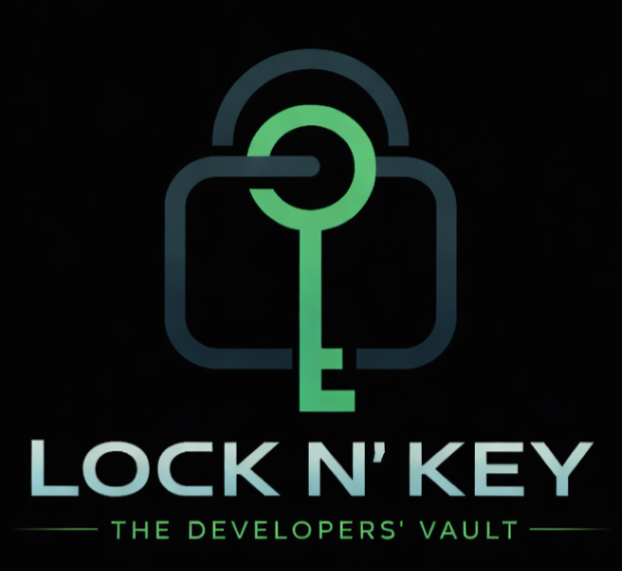

# Lock N' Key: The Developer's Vault

<p align="center">
  
</p>

<p align="center">
  <strong>The vault that never connects. True Security. Zero Trace.</strong>
</p>

<p align="center">
  
  
  
  
  
  
</p>

---

## 💡 The Intuition

Every time you paste an API key, store credentials in unencrypted `.env` files, or trust a cloud password manager, you are expanding your attack surface. Cloud vaults remain high-value targets, and clipboard managers frequently leak sensitive strings across processes and sync services.

**Lock N' Key** was created to eliminate this risk entirely. It is a developer-first secrets manager designed around **Zero Trust Networking**:
* **100% Local-Only:** Your vault is stored exclusively on your physical machine. Absolutely zero telemetry, no sync servers, no external network requests.
* **0% Cloud Trust:** No master keys exist on remote infrastructure. You don't have to trust our servers, because we don't operate any.
* **Developer Velocity:** Access secrets instantly across IDEs, terminals, and CLI workflows without breaking flow.

---

## ✨ Features

* **🔒 Ironclad Local Storage:** Encrypted at rest using AES-256-GCM with locally derived keys.
* **⚡ Global Quick Access (`Alt + Space`):** Trigger a minimalist overlay anywhere on Windows. Search and paste API keys directly into VS Code, Android Studio, or any terminal without relying on persistent clipboard history.
* **👆 Biometric Authentication:** Seamless integration with Windows Hello (Fingerprint & Facial Recognition) for instant, secure unlocking.
* **💻 Developer Secret Resolver CLI (`locknkey`):** Complete terminal suite (`run`, `list`, `get`, `set`, `delete`, `status`). Run your commands with encrypted credentials dynamically resolved into memory.
* **🛡️ Git Leak Guard:** Automatic pre-commit hook (`locknkey hook install`) that audits staged commits against your actual vault secrets to block accidental leaks.
* **📁 Encrypted Secret Files Vault:** Drag-and-drop secure file storage for `.pem`, `.key`, `id_ed25519`, `service-account.json`, `.ovpn`, and `.env` files with in-app text previews and one-click export.
* **📋 2FA Backup Codes Tracker:** Paste multi-code emergency recovery sets with interactive strike-through tracking and low-code depletion alerts.
* **⏳ Secret Health & TTL Expiry:** Set expiration presets (`30d`, `90d`, `1y`) with live dashboard health scoring and warning alerts before keys expire.
* **🧩 Companion Browser Extension:** Dedicated Chrome and Edge extension (Manifest V3) to save credentials directly to your local desktop vault over loopback.
* **🔄 Cross-Device Encrypted Transfer (.lnk):** Securely backup or migrate your vault across machines using password-protected `.lnk` encrypted archives.
* **🪟 Windows System Tray Support:** Runs quietly in the background with auto-lock and quick access controls.

---

## 🛠️ The `locknkey` CLI: Developer Terminal Suite

Lock N' Key includes a native CLI binary built for terminal velocity and script automation.

### Available Commands:
```bash
locknkey run <command> [args...]    # Inject LNK: aliases and execute child process
locknkey list                       # List all stored secrets, types, and expiry statuses
locknkey get <alias> [-c, --copy]   # Output secret value to stdout (or copy to clipboard)
locknkey set <alias> [value]        # Add or update a secret with masked terminal input
locknkey delete <alias>             # Delete a secret from vault
locknkey status                     # Check local daemon status and vault lock state
locknkey hook [install|uninstall]   # Install Git pre-commit leak guard in current repo
locknkey scan [--staged]            # Audit staged git changes against vault secrets
```

### Zero-Plaintext Development Workflow:
1. Define aliases in your `.env` or `.env.local` prefixed with `LNK:`:
   ```env
   # .env
   PORT=3000
   DATABASE_URL=LNK:postgres_prod
   STRIPE_SECRET_KEY=LNK:stripe_test_key
   OPENAI_API_KEY=LNK:my_openai_token
   ```

2. Run your application wrapped with `locknkey run`:
   ```bash
   locknkey run npm start
   # or
   locknkey run python app.py
   # or
   locknkey run docker compose up
   ```

3. **What happens under the hood:**
   - The CLI parses the required aliases from the environment and local `.env` files.
   - It queries the local Lock N' Key daemon via `127.0.0.1:45454/secrets/resolve`.
   - If the vault is locked, the desktop app automatically surfaces a Windows Hello / Master Password prompt.
   - Once authenticated, secrets are injected directly into the spawned process's memory environment.
   - **Nothing is ever written to disk.** Plaintext secrets never leak into source control or command line history.

---

## 🛡️ Git Leak Guard: Never Leak a Secret Again

Prevent accidental commits of active credentials to GitHub or GitLab:

```bash
# Navigate to your Git project root
locknkey hook install
```

When you attempt to `git commit`, the hook scans your staged changes directly against your **actual saved vault secrets**. If a secret is detected in your code, the commit is immediately aborted:
```text
[Lock N' Key Guard] 🚨 CRITICAL: LEAK DETECTED!
Your staged changes contain secrets currently stored in your vault:
  ❌ Secret: "STRIPE_SECRET_KEY" (Shortcut: "stripe_prod")

💡 Replace with 'LNK:stripe_prod' in your .env and run with `locknkey run`.
```

---

## 📥 Installation

Pre-packaged Windows installers are available directly in the [`installers/`](installers/) directory:

1. Download [`installers/lock_n_key_setup.exe`](installers/lock_n_key_setup.exe).
2. Run the installer and follow the setup wizard (adds `locknkey` CLI to your user `PATH` automatically).
3. Launch **Lock N' Key** from your Start Menu or Desktop.

### 🛡️ Windows Defender SmartScreen Note
Because Lock N' Key is an independent open-source tool not signed with an enterprise Extended Validation (EV) certificate ($400+/year), Windows Defender SmartScreen may display an *"Unrecognized app"* warning on initial download:
1. Click **"More info"**.
2. Click **"Run anyway"**.

#### SHA-256 Integrity Verification
You can independently verify that the installer binary has not been tampered with:
```powershell
Get-FileHash .\installers\lock_n_key_setup.exe -Algorithm SHA256
```
**Expected SHA-256 Hash:**
```
BCCC18A7D635CABEDBBB9683A699788EE454880C41551D26B82CD57A11DF68A5
```

---

## 🚀 Getting Started

### 1. Initialize Master Vault
On first launch, create your **Master Password** and configure recovery security questions. This password is used as the key derivation root for your AES-256 encrypted vault.

### 2. Add Secrets
- Open the **Dashboard** and select **"Add Secret"**.
- Provide a name (e.g. `openai_key`), value, and an optional shortcut (e.g. `openai`).
- Shortcuts allow split-second retrieval from the Quick Access overlay and the CLI.

### 3. Quick Access Overlay
- Press **`Alt + Space`** anywhere in Windows.
- Type the name or shortcut of your secret.
- Press **Enter** to paste directly into your active window.

### 4. Install Browser Extension
- From the desktop app, navigate to **Overview** > **Install Extension**.
- Follow the instructions to load the unpacked extension in Chrome or Edge Developer Mode.
- Credentials captured in the browser save directly to your local desktop vault.

### 5. Encrypted Backup & Migration (.lnk)
- **Export:** Navigate to `Settings` > `Export Vault` > `Encrypted Backup (.lnk)`.
- **Set Backup Password:** Encrypt the backup with a strong password.
- **Import:** On your target machine, go to `Settings` > `Import Backup` and provide the backup password.

---

## 🏗️ Building from Source

### Prerequisites
* [Flutter SDK](https://docs.flutter.dev/get-started/install/windows) (v3.10.4 or higher)
* Visual Studio 2022 with **"Desktop development with C++"** workload
* [Inno Setup 6+](https://jrsoftware.org/isdl.php) (optional, for compiling the installer)

### Build Steps

1. **Clone the repository:**
   ```bash
   git clone https://github.com/rtk007/Lock_N-_Key.git
   cd Lock_N-_Key
   ```

2. **Install Flutter dependencies:**
   ```bash
   flutter pub get
   ```

3. **Run in development mode:**
   ```bash
   flutter run -d windows
   ```

4. **Build release desktop bundle:**
   ```bash
   flutter build windows --release
   ```

5. **Compile the CLI executable:**
   ```bash
   dart compile exe bin/locknkey.dart -o build/windows/x64/runner/Release/locknkey.exe
   ```

6. **Compile the Inno Setup installer:**
   - Open [`installers/lock_n_key.iss`](installers/lock_n_key.iss) in Inno Setup.
   - Click **Build** > **Compile** (`Ctrl + F9`).
   - The resulting `lock_n_key_setup.exe` will be generated in `installers/`.

---

## 🌐 Web Showcase

A static product showcase and documentation site is included in [`web_landing/`](web_landing/). It features a high-definition video walkthrough, interactive architecture diagrams, and security specifications.

---

## 🔒 Security Architecture

| Component | Implementation |
|---|---|
| **Encryption Algorithm** | AES-256-GCM authenticated encryption |
| **Key Storage** | Hardware-backed via Windows Hello / DPAPI local store |
| **Local Inter-process API** | Local loopback `127.0.0.1:45454` with CORS restricted origins |
| **Network Outbound** | Zero outbound sockets; strictly air-gapped runtime |
| **CLI Secret Lifespan** | Process memory only; no plaintext disk writes |

---

## 👤 Author

**Ratik Krishna**
* GitHub: [@rtk007](https://github.com/rtk007)
* Repository: [Lock_N-_Key](https://github.com/rtk007/Lock_N-_Key)

Built with ❤️ using Flutter Desktop & Dart.
